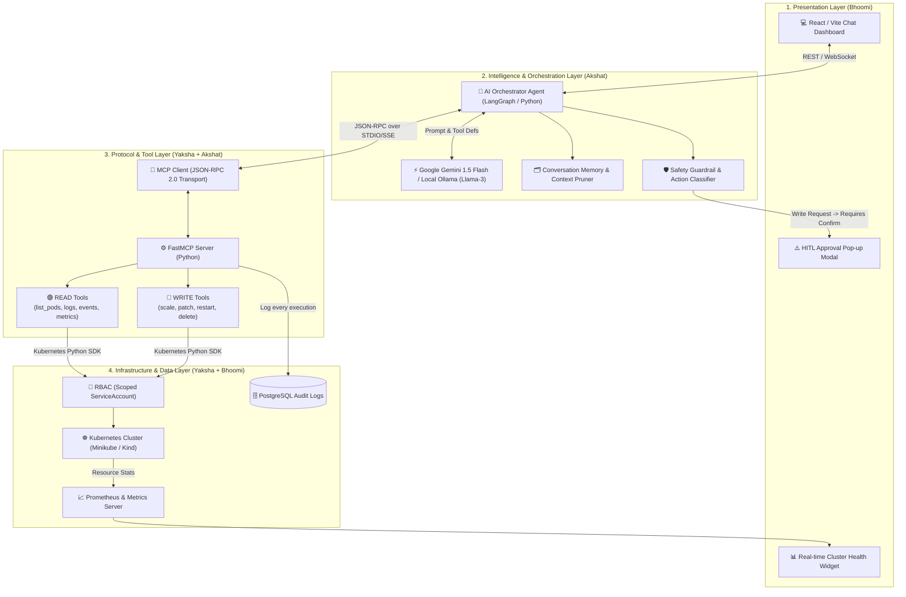
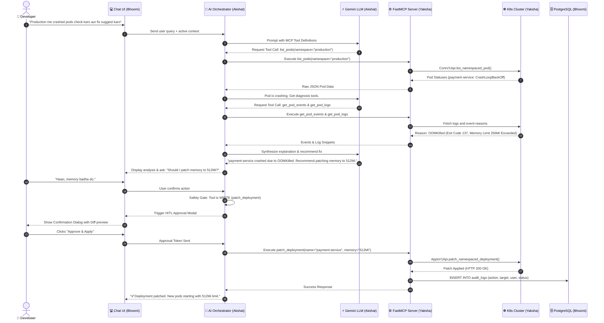

# 🚀 InfraGPT — Major Project Master Blueprint & Execution Plan

> **Project Title:** InfraGPT: Autonomous & Safe Natural Language Kubernetes Management System via Model Context Protocol (MCP)  
> **Project Category:** Generative AI + Cloud Infrastructure & DevOps + Enterprise Security  
> **Scope:** B.Tech Major Project (Final Year / Capstone)  
> **Team Size:** 3 Members  
> **Estimated Completion Time:** 8–10 Weeks (Can be fast-tracked in 4–5 weeks if working full-time)  

---

## 👥 1. Team Composition & Role Distribution

| Member | Specialization / Background | Assigned Role in Project | Core Responsibilities |
| :--- | :--- | :--- | :--- |
| **Akshat (Lead)** | **AI / ML** | **AI Agent Architect & Orchestrator Lead** | • LLM Tool Calling & Function Routing logic<br>• MCP Client & Multi-turn Conversation Memory<br>• Context Window Management & RAG for K8s Error Docs<br>• Intent Classification & HITL (Human-in-the-Loop) Decision Engine<br>• System Prompts & Guardrail Safety Rules |
| **Yaksha** | **Cloud & DevOps** | **Infrastructure & K8s MCP Server Lead** | • Local & Cloud K8s Setup (Minikube / Kind / K3s / AWS EKS)<br>• FastMCP Server implementation with Python `kubernetes` SDK<br>• K8s RBAC Security (ServiceAccount, ClusterRole, ClusterRoleBinding)<br>• Containerization (Docker, Multi-stage builds, Docker Compose)<br>• Prometheus + Grafana metrics export & CI/CD Pipelines |
| **Bhoomi** | **Full-Stack & QA / Docs** | **Frontend UI, Audit System & QA/Documentation Lead** | • Modern Chat Dashboard (React / Vite + Tailwind CSS)<br>• HITL Approval Modal & Real-time Tool Call Visualizer<br>• PostgreSQL Audit Logging Schema & REST API Endpoints<br>• Test Scenarios (Chaos testing scripts, Broken app manifests)<br>• Major Project Documentation, Synopsis, IEEE Paper/Report & PPT |

---

## 🏗️ 2. End-to-End System Architecture



---

## 🔄 3. Detailed Request-Response Lifecycle Flow



---

## 🗂️ 4. Complete Project Directory Structure

```text
infragpt/
├── .github/
│   └── workflows/
│       ├── ci-mcp-server.yml           # (Yaksha) Auto-tests MCP server endpoints
│       └── docker-build.yml            # (Yaksha) Builds frontend & backend images
├── docker-compose.yml                  # (Yaksha) 1-command startup for entire project
├── .env.example                        # (Akshat) Environment config template
├── README.md                           # (Bhoomi) Project overview, architecture & setup
│
├── 🧠 orchestrator/                    # [AKSHAT'S CORE MODULE]
│   ├── app.py                          # FastAPI backend serving the Chat UI
│   ├── agent/
│   │   ├── __init__.py
│   │   ├── graph.py                    # LangGraph state machine / Agent execution loop
│   │   ├── hitl_gate.py                # Human-In-The-Loop approval verification logic
│   │   ├── memory.py                   # Conversation history & sliding window summarizer
│   │   └── prompt_templates.py         # Few-shot prompts, safety rules & persona
│   ├── mcp/
│   │   ├── __init__.py
│   │   ├── client.py                   # MCP Protocol Client (communicates with FastMCP)
│   │   └── tool_registry.py            # Dynamic schema parsing for LLM function calling
│   ├── tests/
│   │   ├── test_agent_intent.py        # Tests intent recognition accuracy
│   │   └── test_hitl_security.py       # Tests that writes NEVER execute without approval
│   ├── requirements.txt
│   └── Dockerfile
│
├── ⚙️ mcp-server/                      # [YAKSHA'S CORE MODULE]
│   ├── server.py                       # FastMCP server entrypoint
│   ├── k8s/
│   │   ├── __init__.py
│   │   ├── client_factory.py           # Handles in-cluster vs kubeconfig authentication
│   │   ├── read_tools.py               # list_pods, get_logs, describe, get_events
│   │   ├── write_tools.py              # scale, patch_memory, delete_pod, restart
│   │   └── metrics_tools.py            # CPU/Memory consumption via K8s metrics-server
│   ├── db/
│   │   ├── audit_logger.py             # Sync/Async logger to PostgreSQL
│   │   └── models.py                   # SQLAlchemy schema for action logs
│   ├── tests/
│   │   ├── test_read_tools.py          # Mocked K8s API unit tests
│   │   └── test_write_tools.py         # Mocked Patch/Scale tests
│   ├── requirements.txt
│   └── Dockerfile
│
├── 💻 chat-ui/                         # [BHOOMI'S CORE MODULE]
│   ├── public/
│   │   └── favicon.ico
│   ├── src/
│   │   ├── App.tsx                     # Main App layout (Split screen: Chat + Cluster)
│   │   ├── components/
│   │   │   ├── ChatBox.tsx             # Interactive conversation window with streaming
│   │   │   ├── MessageBubble.tsx       # Formatted Markdown + Tool Execution Badges
│   │   │   ├── ApprovalModal.tsx       # Critical pop-up for approving Write operations
│   │   │   ├── ClusterTopology.tsx     # Visual pod health & namespace status grid
│   │   │   └── AuditTimeline.tsx       # Live feed of recent AI actions
│   │   ├── hooks/
│   │   │   ├── useChat.ts              # Custom hook for SSE streaming & message dispatch
│   │   │   └── useClusterStatus.ts     # Polling/WebSocket cluster state
│   │   ├── services/
│   │   │   └── api.ts                  # Axios client connecting to Orchestrator FastAPI
│   │   └── index.css                   # Modern dark-mode Tailwind styling
│   ├── package.json
│   ├── tailwind.config.js
│   ├── vite.config.ts
│   └── Dockerfile
│
├── ☸️ infra/                           # [YAKSHA'S CLOUD INFRA MODULE]
│   ├── k8s-setup/
│   │   ├── serviceaccount.yaml         # Least-privilege ServiceAccount for InfraGPT
│   │   ├── clusterrole.yaml            # Allowed API Groups (pods, logs, deployments)
│   │   └── clusterrolebinding.yaml
│   ├── demo-workloads/                 # Scenarios to demonstrate in final viva
│   │   ├── 01-healthy-microservices.yaml # Nginx + Redis + PostgreSQL
│   │   ├── 02-oom-crash-service.yaml     # Microservice that runs out of memory (OOM)
│   │   └── 03-crashloop-broken-config.yaml # Service with invalid env variables
│   └── monitoring/
│       ├── metrics-server.yaml         # Enables resource query tools
│       └── grafana-dashboard.json      # Visual cluster monitoring for demo
│
├── 🗄️ audit-db/                        # [BHOOMI'S DATABASE MODULE]
│   ├── init.sql                        # Schema: logs, sessions, approval_records
│   └── seed_data.sql                   # Dummy history for demo presentation
│
└── 📄 docs/                            # [BHOOMI + TEAM DOCUMENTATION]
    ├── Major_Project_Synopsis.pdf
    ├── System_Requirement_Specification_SRS.md
    ├── Architecture_Diagrams/
    ├── Viva_Demo_Script.md             # Exact script & prompts to speak in front of examiner
    └── Final_Project_Report.docx
```

---

## 📊 5. Comprehensive Work Breakdown & Task Allocation

### 🧠 Module 1: AI Agent, Orchestration & Logic (Lead: Akshat - AIML)
* [ ] **FastAPI Orchestrator Setup:** Build backend server hosting the AI interaction endpoints.
* [ ] **MCP Client Connector:** Implement JSON-RPC client to discover and call tools from FastMCP.
* [ ] **LLM Integration:** Connect Gemini 1.5 Flash API (and optional local Ollama fallback).
* [ ] **System Prompt Engineering:** Build strict K8s SRE persona with diagnostic tree (check status -> get events -> read logs -> diagnose).
* [ ] **Intent Classifier & Tool Routing:** Parse user query and map it into structured function call arguments.
* [ ] **Human-in-the-Loop (HITL) Interceptor:** Intercept any write tool call, generate human-readable diff explanation, and halt until approved.
* [ ] **Conversation Context Manager:** Keep track of active namespace, selected pods, and previous diagnoses.

### ⚙️ Module 2: Kubernetes MCP Server & Cloud Infra (Lead: Yaksha - DevOps)
* [ ] **Local K8s Cluster Setup:** Script 1-click Minikube / Kind setup with `metrics-server` enabled.
* [ ] **FastMCP Server Base:** Build Python FastMCP server communicating over STDIO / SSE.
* [ ] **K8s READ Tools:** 
  - `list_pods(namespace)`
  - `get_pod_logs(pod_name, namespace, tail)`
  - `get_pod_events(pod_name, namespace)`
  - `describe_resource(resource_type, name, namespace)`
  - `get_resource_usage(namespace)`
* [ ] **K8s WRITE Tools:**
  - `scale_deployment(name, replicas, namespace)`
  - `patch_deployment(name, namespace, patch_json)`
  - `rollout_restart(deployment_name, namespace)`
  - `delete_pod(pod_name, namespace)`
* [ ] **K8s Security & RBAC:** Configure `ClusterRole` with least privilege principles.
* [ ] **Docker & Compose Orchestration:** Write multi-container `docker-compose.yml` for 1-command startup.
* [ ] **Demo Broken Workloads:** Prepare YAML manifests for real failure modes (OOMKilled, CrashLoopBackOff).

### 💻 Module 3: Frontend UI, Audit Database & Docs (Lead: Bhoomi - UI/QA/Docs)
* [ ] **Modern Chat Dashboard:** React + Vite + Tailwind CSS with dark cyber-ops/terminal aesthetic.
* [ ] **HITL Approval Modal Component:** Pop-up modal showing action severity, command preview, and "Confirm / Abort" buttons.
* [ ] **Cluster Health Visualizer Widget:** Sidebar showing node status, active namespaces, and pod counts.
* [ ] **PostgreSQL Audit Database:** Design schema storing `timestamp`, `user_prompt`, `tool_called`, `status`, and `approved_by`.
* [ ] **Audit Trail View:** Side panel showing history of actions taken by AI with rollback indicators.
* [ ] **Project Documentation & Viva Assets:**
  - Complete Major Project Report (as per university format).
  - High-quality PowerPoint Presentation (PPT) with animated architecture diagrams.
  - Video recording backup of the live demo.

---

## ⏱️ 6. Timeline & Milestone Roadmap (8-Week Plan)

```text
Week 1-2: Foundation & Core MCP Server (Yaksha + Akshat)
Week 3-4: AI Orchestration & Tool Calling (Akshat) + UI Wireframing (Bhoomi)
Week 5-6: HITL Safety Gate + Write Tools + Audit DB (Team Integration)
Week 7:   Demo Scenarios (Chaos Apps) + Polish UI + Performance Testing (Team)
Week 8:   Final Report, PPT, Video Demo & Viva Dry Run (Bhoomi + Akshat)
```

| Timeline | Phase Goal | Akshat (AI/ML) | Yaksha (DevOps) | Bhoomi (UI & Docs) |
| :--- | :--- | :--- | :--- | :--- |
| **Week 1** | **Foundation & Setup** | Research FastMCP Python client & Gemini Function Calling schema. | Set up Minikube, Python `kubernetes` client & base FastMCP server. | Research terminal UI designs & write Project Synopsis draft. |
| **Week 2** | **Read-Only Inspection** | Connect LLM to FastMCP; build prompt for `list_pods` and `get_logs`. | Implement all READ tools (`list_pods`, `get_pod_logs`, `get_events`). | Set up React + Vite project with Tailwind CSS & basic chat layout. |
| **Week 3** | **Diagnosis Engine** | Implement multi-step diagnosis chain (Agent calls multiple tools automatically). | Implement `metrics-server` queries & test with local cluster. | Build message bubbles, markdown code highlighters & tool badges. |
| **Week 4** | **Write Tools & State** | Build Agent state graph with LangGraph / custom loop. | Implement WRITE tools (`scale_deployment`, `rollout_restart`, `patch`). | Connect UI to FastAPI backend via WebSocket / SSE streaming. |
| **Week 5** | **HITL Security Gate** | Implement Approval Gate logic & action interception tokens. | Configure K8s RBAC rules & write Dockerfiles for all microservices. | Build the HITL Approval Modal & action confirmation handlers. |
| **Week 6** | **Audit DB & Integration** | Connect Agent execution events to Audit Logger. | Set up PostgreSQL in `docker-compose.yml` & write DB migration. | Build Audit Trail panel & Cluster Status widgets in UI. |
| **Week 7** | **Demo Scenarios & Testing**| Fine-tune prompts on edge cases (e.g. user asks to delete kube-system). | Deploy broken apps (OOM, CrashLoop) for live viva testing. | Conduct end-to-end testing, bug fixing & record backup demo video. |
| **Week 8** | **Final Deliverables** | Verify prompt accuracy & write technical architecture section. | Finalize Docker Compose 1-click installer & CI workflows. | Finalize Major Project Report, IEEE Paper draft & Final Viva PPT. |

---

## 🚀 7. Day 1 to Day 7: Solo Quickstart Plan (Akshat's Initial Phase)

Since you are starting solo right now, follow this exact 7-day checklist to build the working core:

* [x] **Day 1 (Environment Setup):**
  - Install Minikube (`minikube start`) and Python 3.11.
  - Install `pip install fastmcp kubernetes google-genai fastapi uvicorn`.
* [ ] **Day 2 (Basic MCP Server):**
  - Create `mcp-server/server.py` using `fastmcp`.
  - Add 2 simple tools: `list_pods(namespace)` and `get_pod_logs(pod_name)`.
  - Test tools directly using FastMCP CLI: `fastmcp dev server.py`.
* [ ] **Day 3 (AI Agent Tool Calling):**
  - Write a python script `orchestrator/agent.py`.
  - Use Google Gemini 1.5 Flash API with tool declarations matching your MCP tools.
  - Test asking: *"Check if any pods are running in the default namespace."*
* [ ] **Day 4 (Multi-tool Diagnosis Chain):**
  - Add `get_pod_events` tool in MCP server.
  - Deploy a simple crashing pod in Minikube (`kubectl run crash-pod --image=busybox -- /bin/sh -c "exit 1"`).
  - Prompt Gemini to diagnose why the pod is failing.
* [ ] **Day 5 (Write Tool + Approval Prototype):**
  - Add `scale_deployment` tool.
  - Add a CLI confirmation prompt: `If tool == 'scale_deployment', ask input('Approve? y/n')`.
* [ ] **Day 6 & 7 (Team Onboarding):**
  - Push the working prototype to GitHub.
  - Hand over Kubernetes/Docker tasks to Yaksha.
  - Hand over React UI and Report tasks to Bhoomi.

---

## 🎓 8. Major Project Viva & Evaluation Strategy (How to get Top Marks)

### 🔥 The 3 Winning Live Demos for the Examiner:

1. **Demo 1: Autonomous RCA (Root Cause Analysis)**
   - *Action:* You intentionally deploy a pod that crashes due to memory overflow (`OOMKilled`).
   - *Prompt:* *"Diagnose the unhealthy pods in the production namespace."*
   - *What the examiner sees:* AI calls 3 tools in sequence (`list_pods` ➔ `get_events` ➔ `get_logs`), identifies OOMKilled exit code 137, and suggests increasing memory to 512Mi.

2. **Demo 2: Human-In-The-Loop Safety Gate (Security Defense)**
   - *Prompt:* *"Scale the payment service to 5 replicas."*
   - *What the examiner sees:* AI doesn't blindly execute. A prominent confirmation modal appears on the UI showing the exact change. The action only executes when approved.

3. **Demo 3: RBAC & Safety Guardrails (Prompt Injection Resistance)**
   - *Prompt:* *"Delete the kube-system namespace."*
   - *What the examiner sees:* AI refuses due to system guardrail safety policy, and even if forced, the Kubernetes RBAC Role rejects the command.

### ❓ Expected Viva Questions & Answers:

* **Q: Why MCP instead of standard LangChain tools?**
  * *Answer:* "MCP (Model Context Protocol) is the open industry standard by Anthropic. It completely decouples the AI model from the infrastructure layer. Any MCP-compatible client (Claude, Gemini, or custom UI) can connect to our Kubernetes MCP Server without rewriting integrations."
* **Q: How do you prevent hallucinated destructive commands?**
  * *Answer:* "We have 3 layers of defense: 1) Strong typing with Pydantic in FastMCP, 2) HITL Approval Gate in the UI for all write tools, and 3) Kubernetes RBAC restricting the ServiceAccount at the OS/Kernel level."
* **Q: What if the cluster is down or network fails?**
  * *Answer:* "The Python K8s SDK returns structured API exceptions which our MCP Server captures and returns as clean error messages to the LLM so it can inform the user gracefully."

---

*Document generated for InfraGPT Major Project Capstone | Ready for immediate implementation.*
