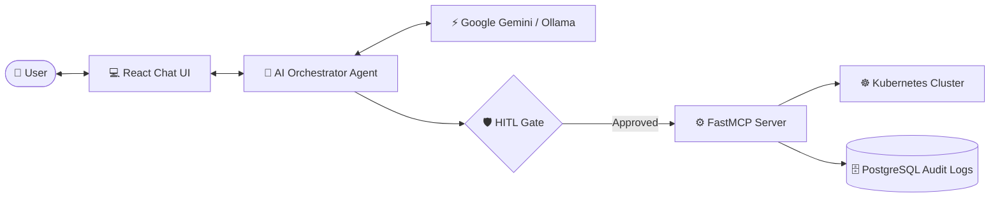

# 🌐 InfraGPT: Natural Language Kubernetes Manager via MCP

[](https://opensource.org/licenses/MIT)
[](https://python.org)
[](https://modelcontextprotocol.io)
[](https://kubernetes.io)
[](https://reactjs.org)

> **InfraGPT** is an autonomous and secure Kubernetes management system powered by the **Model Context Protocol (MCP)** and LLMs. It enables engineers to inspect, diagnose, and manage Kubernetes clusters using natural language with strict **Human-in-the-Loop (HITL)** safety guardrails and RBAC scoping.

---

## 🌟 Key Features

- 🩺 **Autonomous Root Cause Analysis (RCA):** Automatically discovers failing pods, correlates event logs, reads stack traces, and pinpoints root causes (e.g. `OOMKilled`, `CrashLoopBackOff`).
- 💬 **Natural Language Cluster Ops:** Scale deployments, rollout restarts, check resource usage, and query namespaces with plain English.
- 🛡️ **Human-in-the-Loop (HITL) Safety Gate:** All destructive write operations (`scale`, `patch`, `delete`) require explicit human confirmation via interactive UI modals before execution.
- 🔐 **Kubernetes RBAC Hardened:** Operates under dedicated least-privilege `ServiceAccount` and `ClusterRole` definitions.
- 📝 **Full Audit Trail:** Every user prompt, tool execution, and approval is persisted to a PostgreSQL audit log.

---

## 🏗️ Architecture Overview



---

## 👥 Team & Roles

| Member | Role | Focus Area |
| :--- | :--- | :--- |
| **Akshat** | AI/ML| AI Orchestrator, LLM Tool Calling, LangGraph state, HITL Gate & Memory |
| **Yaksha** | Cloud & DevOps Lead | FastMCP K8s Server, RBAC, Minikube/Kind, Docker Compose & CI/CD |
| **Bhoomi** | Full-Stack & QA/Docs Lead | React Chat UI, HITL Modal, PostgreSQL Audit DB, Test Cases & Docs |

---

## 🗂️ Project Structure

```text
infragpt/
├── orchestrator/           # AI Agent Brain (FastAPI + LangGraph + Gemini)
├── mcp-server/             # Kubernetes FastMCP Server (Read & Write Tools)
├── chat-ui/                # React + Vite Dark Monospace Chat Dashboard
├── infra/                  # K8s Manifests, RBAC configs & Demo Workloads
├── docs/                   # Major Project Synopsis, Report & Architecture Docs
├── docker-compose.yml      # 1-command startup for entire stack
└── README.md
```

---

## 🚀 Quickstart

### Prerequisites
- Python 3.11+
- Node.js 18+
- Docker & Docker Compose
- Minikube or Kind local Kubernetes cluster

```bash
# 1. Clone the repository
git clone https://github.com/minor-project-infraGpt/Infra_GPT.git
cd Infra_GPT

# 2. Configure environment. The default is the built-in simulator,
#    which does not use the kubeconfig on this machine.
cp .env.example .env

# 3. Local dashboard (no cluster required)
chmod +x scripts/dev.sh
./scripts/dev.sh
# UI: http://127.0.0.1:3000    API: http://127.0.0.1:8888

# 4. Or launch the full stack, including PostgreSQL audit storage
docker compose up --build
```

---

## 📄 License
This project is open-source under the [MIT License](LICENSE).
