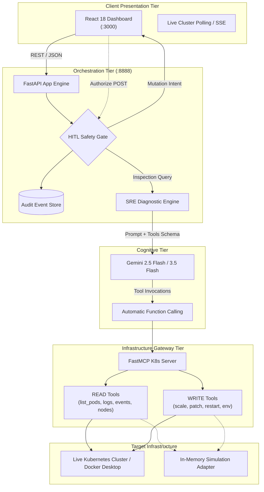

# InfraGPT System Architecture & Security Whitepaper

---

### Executive Summary

InfraGPT introduces a dual-layer architectural model for cloud-native infrastructure automation:
1. **The Intelligence Layer:** An asynchronous multi-turn SRE reasoning agent powered by Google Gemini 2.5 Flash.
2. **The Execution & Governance Layer:** A Model Context Protocol (MCP) tool gateway with hardware-isolated HITL state-machine verification and strictly scoped Kubernetes RBAC enforcement.

---

### Architectural Component Diagram

---

### Tooling Specification Matrix

| Tool Identifier | Access Level | Description | Target Kubernetes API |
| :--- | :--- | :--- | :--- |
| `list_pods` | 🟢 READ | Lists pod statuses, readiness, and restarts | `CoreV1Api.list_namespaced_pod` |
| `get_pod_logs` | 🟢 READ | Fetches stdout/stderr error logs | `CoreV1Api.read_namespaced_pod_log` |
| `get_pod_events` | 🟢 READ | Fetches Kubernetes warning events | `CoreV1Api.list_namespaced_event` |
| `get_cluster_nodes` | 🟢 READ | Node capacity, CPU, and RAM allocation | `CoreV1Api.list_node` |
| `list_deployments` | 🟢 READ | Desired vs available replica status | `AppsV1Api.list_namespaced_deployment` |
| `patch_deployment_resources`| 🔴 WRITE (HITL) | Updates CPU/Memory limits | `AppsV1Api.patch_namespaced_deployment` |
| `set_deployment_env` | 🔴 WRITE (HITL) | Injects missing config/env variables | `AppsV1Api.patch_namespaced_deployment` |
| `scale_deployment` | 🔴 WRITE (HITL) | Adjusts replica count | `AppsV1Api.patch_namespaced_deployment_scale` |
| `rollout_restart` | 🔴 WRITE (HITL) | Restarts all deployment pods | `AppsV1Api.patch_namespaced_deployment` |
| `delete_pod` | 🔴 WRITE (HITL) | Force terminates a pod replica | `CoreV1Api.delete_namespaced_pod` |

---

### Security Architecture & Least-Privilege RBAC

InfraGPT avoids granting `cluster-admin` access. The agent operates under a dedicated `infragpt-agent-sa` bound to an immutable `ClusterRole`:

1. **Read Scopes:** Restricted to `pods`, `events`, `services`, `deployments`, and `nodes`.
2. **Write Scopes:** Limited to `deployments`, `deployments/scale`, and specific `pods` deletion.
3. **No Secret Reading:** InfraGPT cannot read raw Kubernetes `Secret` resources by default, preventing accidental token leakage in LLM prompts.
