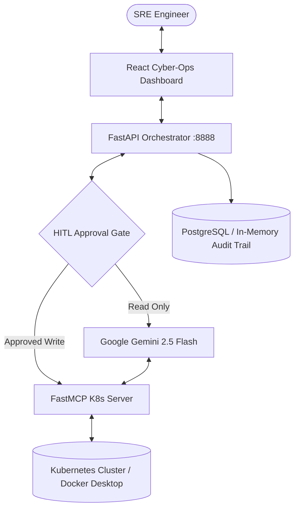

# Software Requirements Specification (SRS)
## InfraGPT: Autonomous Site Reliability Engineering & Kubernetes Governance Assistant

---

### 1. Introduction

#### 1.1 Purpose
This document specifies the software requirements for **InfraGPT**, an autonomous AI-driven Site Reliability Engineering (SRE) and Kubernetes cluster governance platform. It provides natural language diagnostics, root-cause analysis (RCA), automated self-healing, and security-governed mutation through Human-In-The-Loop (HITL) authorization gates.

#### 1.2 Scope
InfraGPT interfaces with Kubernetes clusters through the Model Context Protocol (MCP) using a FastMCP server, coordinating Large Language Models (Google Gemini 2.5 Flash / Gemini 3.5 Flash) to inspect cluster topology, detect pod failure modes (e.g., `OOMKilled`, `CrashLoopBackOff`, `ImagePullBackOff`), and safely execute remediation (resource limit patching, replica scaling, rolling restarts) with an enterprise audit log trail.

#### 1.3 Definitions, Acronyms, and Abbreviations
* **SRE:** Site Reliability Engineering
* **MCP:** Model Context Protocol (Anthropic standard for AI tool calling)
* **HITL:** Human-In-The-Loop (mandatory authorization gate for write operations)
* **RCA:** Root Cause Analysis
* **RBAC:** Role-Based Access Control
* **OOM:** Out Of Memory (`Exit Code 137`)

---

### 2. Overall Description

#### 2.1 Product Perspective
InfraGPT operates as a specialized control-plane sidecar or external management dashboard. It consists of three decoupled architectural tiers:
1. **Frontend Presentation Tier:** React 18 + Vite Cyber-Ops SRE Dashboard.
2. **AI Orchestration & Governance Tier:** FastAPI REST engine with Gemini LLM integration and HITL state-machine.
3. **Cluster Interface Tier:** FastMCP Python server executing scoped Kubernetes API operations against real or simulated clusters.

#### 2.2 User Personas
* **DevOps / SRE Lead:** Diagnoses production outages, inspects application logs, and authorizes resource patches.
* **Backend Developer:** Checks deployment health and rolling update status without needing raw `kubectl` command-line access.
* **Security & Compliance Officer:** Reviews tamper-evident audit logs to verify who authorized cluster changes.

---

### 3. Functional Requirements

#### 3.1 Autonomous Diagnostic Engine (FR-1)
* **FR-1.1:** The system shall automatically scan the active namespace for degraded pods (`CrashLoopBackOff`, `OOMKilled`, `Error`, `Pending`).
* **FR-1.2:** Upon detecting an anomaly, the system shall correlate Kubernetes lifecycle events (`get_pod_events`) and container stdout/stderr logs (`get_pod_logs`).
* **FR-1.3:** The system shall synthesize findings into a structured Root Cause Analysis (RCA) containing problem phase, exit code analysis, and recommended remediation.

#### 3.2 Human-in-the-Loop (HITL) Security Governance (FR-2)
* **FR-2.1:** All state-mutating operations (`scale_deployment`, `patch_deployment_resources`, `set_deployment_env`, `rollout_restart`, `delete_pod`) MUST be intercepted before execution.
* **FR-2.2:** The system shall generate a cryptographically unique `approval_id` (UUIDv4) and render an interactive confirmation modal displaying target namespace, deployment, and parameter diff.
* **FR-2.3:** No mutating action shall execute unless explicit cryptographic approval is received via `POST /api/chat/approve`.

#### 3.3 Dynamic Multi-Model LLM Resilience (FR-3)
* **FR-3.1:** The orchestration tier shall support zero-shot function calling using Google Gemini 2.5 Flash and Gemini 3.5 Flash.
* **FR-3.2:** If external API quotas are exhausted or rate-limited (HTTP 429 / 503), the system shall automatically fail over across candidate models and fallback to the built-in deterministic SRE rule compiler with zero downtime.

#### 3.4 Multi-Container Topology Monitoring (FR-4)
* **FR-4.1:** The UI shall poll cluster state at 3-second intervals to display healthy vs degraded pod counts in real time.
* **FR-4.2:** Pod indicators shall visually reflect health transitions: Green for `Running (Ready)` and pulsing Rose for `CrashLoopBackOff`.

---

### 4. Non-Functional Requirements

* **NFR-1 (Performance):** The HITL write-interceptor shall process requests in less than 10 milliseconds.
* **NFR-2 (Reliability):** Dual-mode adapter ensures 100% testability offline via in-memory mock fallback when no live kubeconfig is detected.
* **NFR-3 (Security):** Enforces Kubernetes least-privilege RBAC through scoped `ClusterRole` (no cluster-admin privileges required).
* **NFR-4 (Usability):** UI follows Cyber-Ops dark theme with zero cartoon emojis, full Markdown table rendering, and high-contrast typography.
